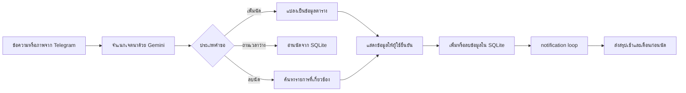

# Secretary Bot

Telegram bot สำหรับจัดการตารางนัดหมายด้วยข้อความภาษาไทยหรือภาพตาราง ระบบใช้ Gemini ช่วยจำแนกเจตนาและแปลงข้อมูลเป็นรายการนัด ก่อนให้ผู้ใช้ยืนยันแล้วจึงบันทึกลง SQLite

> สถานะ: ต้นแบบที่มีโค้ดครบสำหรับรันบนเครื่อง ต้องใช้ Telegram Bot Token และ Gemini API Key ของผู้ทดสอบเอง ยังไม่มี automated test suite และไม่ได้ทดสอบส่งข้อความผ่านบัญชี production ในงานปรับปรุงเอกสารนี้

## ความสามารถที่ตรวจสอบได้จากโค้ด

- รับคำสั่ง `/start`, `/list`, `/delete` และ `/notify`
- เพิ่มนัดจากข้อความ และแสดงรายการที่แปลงได้ก่อนขอคำยืนยัน
- อ่านภาพตารางด้วย Gemini Vision แล้วขอคำยืนยันก่อนบันทึก
- ค้นหาเวลาว่างจากนัดที่เก็บไว้
- ลบนัดผ่านข้อความหรือปุ่มยืนยัน
- แยกข้อมูลผู้ใช้ด้วย Telegram user ID และเก็บใน SQLite
- ส่งสรุปประจำวันเวลา 07:00 และตรวจนัดที่กำลังมาถึงล่วงหน้า 15 นาที เมื่อเปิดการแจ้งเตือน

## Workflow



## ตัวอย่างการใช้งาน

ตัวอย่างต่อไปนี้เป็นข้อมูลสังเคราะห์เพื่ออธิบายรูปแบบการทำงาน ไม่ใช่ผลจากผู้ใช้จริง

**ข้อความเข้า**

```text
พรุ่งนี้ 13:30-14:30 ประชุมสรุปงานกับทีม Automation
```

**ผลที่ bot เตรียมให้ตรวจสอบก่อนบันทึก**

```text
หัวข้อ: ประชุมสรุปงานกับทีม Automation
วันที่: [วันที่ที่ระบบตีความจากคำว่า "พรุ่งนี้"]
เวลา: 13:30-14:30
```

ผู้ใช้ต้องกดยืนยันก่อนข้อมูลถูกเพิ่มลงฐานข้อมูลจริง

## เทคโนโลยี

- Python 3
- `python-telegram-bot`
- Google Gemini ผ่าน `google-genai`
- SQLite
- Pillow สำหรับข้อมูลภาพ

## ติดตั้งและรันบนเครื่อง

```powershell
git clone https://github.com/BossZY27/secretary-bot.git
cd secretary-bot
python -m venv .venv
.\.venv\Scripts\Activate.ps1
python -m pip install -r requirements.txt
Copy-Item .env.example .env
```

กรอกค่าของตัวเองใน `.env`:

```dotenv
TELEGRAM_BOT_TOKEN=your_telegram_bot_token
GEMINI_API_KEY=your_gemini_api_key
```

จากนั้นเริ่ม bot:

```powershell
python bot.py
```

ห้าม commit ไฟล์ `.env` หรือ token จริงขึ้น repository

## โครงสร้างหลัก

| ไฟล์ | หน้าที่ |
|---|---|
| `bot.py` | Telegram handlers, confirmation flow และการเริ่ม notification loop |
| `gemini_brain.py` | จำแนกเจตนา แปลงข้อความ/ภาพ และตอบคำถามเกี่ยวกับตาราง |
| `database.py` | schema และ CRUD สำหรับนัดหมายกับการตั้งค่าแจ้งเตือน |
| `notifier.py` | สรุปนัดประจำวันและแจ้งเตือนก่อนถึงเวลา |
| `.env.example` | รายชื่อ environment variables ที่ต้องตั้ง |

## ข้อจำกัดที่ทราบ

- การตีความภาษาและภาพขึ้นกับผลตอบกลับของ Gemini จึงควรตรวจข้อมูลก่อนยืนยันทุกครั้ง
- notification loop ทำงานอยู่ใน process เดียวกับ bot; หาก process หยุด การแจ้งเตือนจะหยุดด้วย
- SQLite เหมาะกับต้นแบบหรือการใช้งานขนาดเล็ก หากใช้งานหลาย instance ควรเปลี่ยนเป็นฐานข้อมูลส่วนกลาง
- ยังไม่มี automated tests สำหรับ Telegram handlers และ Gemini integration

## การทดสอบแบบปลอดภัย

ตรวจ syntax โดยไม่เชื่อมต่อ Telegram หรือ Gemini:

```powershell
python -m compileall bot.py database.py gemini_brain.py notifier.py
```
